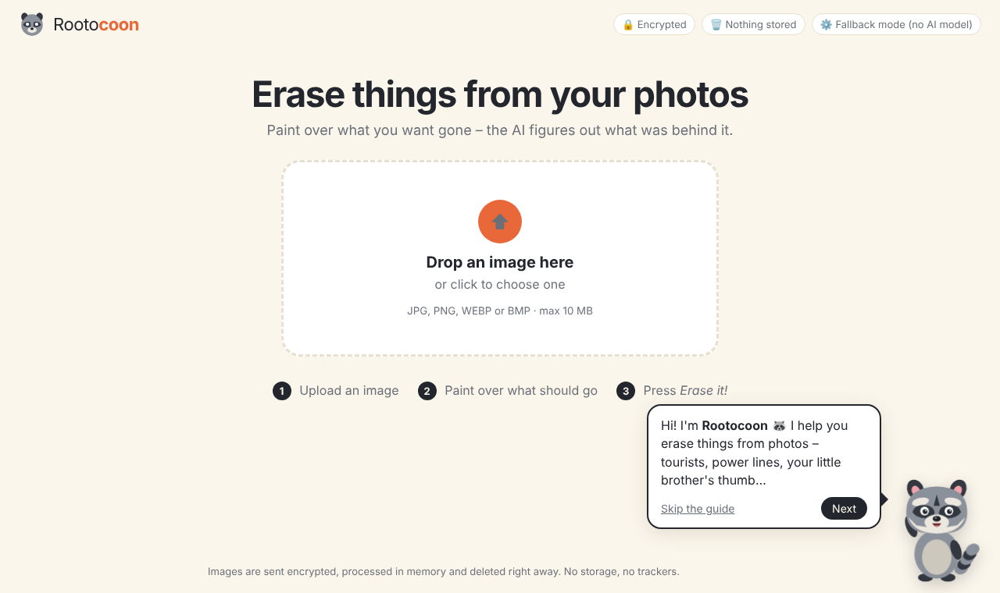
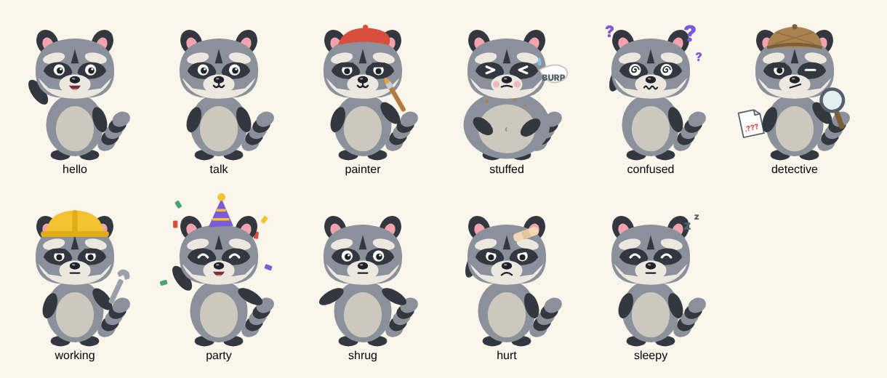

# Rootocoon

Rootocoon is a website that removes things from photos. You upload an image, paint over what you want gone, and an AI fills in what was most likely behind it – similar to Roto Brush and Content-Aware Fill in Adobe's tools. The raccoon mascot, also called Rootocoon, guides you through it and changes costume depending on what happens.

Rootocoon is a web app: a Python server runs the AI, and you use it in your browser. It can run on your own computer for development, or on a server such as AWS EC2 so that anyone can use it.

**Live version:** https://rootocoon.duckdns.org (hosted on AWS EC2 in Stockholm; the server is switched off when not in use)



## Features

| Requirement | How it is solved |
|---|---|
| Upload an image | Drag and drop, click to choose, or paste with Ctrl+V |
| Brush to select | Brush and eraser, brush size from 2 to 200 px (buttons, slider, or Ctrl + drag like After Effects), undo/redo, clear. Works with mouse, pen and touch |
| Image info | File name, size in pixels, aspect ratio, file size and format shown above the image |
| No quality loss | Downloads keep the uploaded resolution: JPG at maximum quality or lossless PNG |
| AI fills in the background | The LaMa model guesses what was behind the object from its surroundings |
| Uses the GPU | Picks NVIDIA (CUDA) → Apple Silicon (MPS) → CPU automatically |
| Rejects non-image files | Reads the file's first bytes ("magic numbers"), so a `.txt` renamed to `.jpg` is caught |
| Rejects corrupt files | The whole image is decoded before use; truncated or broken files are refused |
| File size limit | 10 MB (change `MAX_MB` in `server/imagecheck.py`) and max 40 megapixels |
| Encrypted | HTTPS/TLS for all traffic, plus strict security headers |
| Nothing stored | Images only live in RAM, no logs, `Cache-Control: no-store` |
| Mascot with a guide | Speech bubbles, a "Skip the guide" button, click the raccoon to get help again |

### Rootocoon's costumes



| Event | Costume |
|---|---|
| Welcome | Waving |
| You are painting | Painter's beret and brush |
| File is too big | Huge belly, sweat drop and "BURP" |
| File is not an image | Detective hat and magnifying glass |
| File is corrupt | Swirly eyes and question marks |
| The AI is working | Hard hat and wrench |
| Done | Party hat and confetti |
| Nothing selected | Shrugs |
| Server error | Band-aid on the head |
| Idle for one minute | Falls asleep |

## Getting started

You need **Python 3.10 or newer** ([python.org](https://www.python.org/downloads/)). On Windows, tick **"Add python.exe to PATH"** during installation.

```bash
# 1. Install the packages
pip install -r requirements.txt

# 2. Install PyTorch (the AI engine) - pick ONE line
pip install torch --index-url https://download.pytorch.org/whl/cu121   # Windows/Linux with an NVIDIA card
pip install torch                                                       # Mac, or no NVIDIA card

# 3. Download the AI model (about 200 MB)
python download_model.py

# 4. Start the server
python run.py
```

Open **https://localhost:8443**. The first time, the browser warns about the certificate – click *Advanced → Proceed to localhost* (explained below). Stop the server with **Ctrl+C** in the terminal.

When you open the page, the terminal shows where the AI runs, e.g. `[AI] LaMa loaded on: cuda` (graphics card) or `cpu`. If it says PyTorch or the model is missing, a simpler fallback method with blurrier results is used instead.

## How it works

```
Browser                                      Server (Python, FastAPI)
───────                                      ────────────────────────
1. Checks size, format and whether
   the image can be opened
2. Sends the file ───── HTTPS ──────────▶  /api/check: validates again, stores nothing
3. You paint a mask
4. Cuts out the area around the mask
   and sends crop + mask ───── HTTPS ───▶  /api/inpaint: LaMa on the GPU fills it in
5. Pastes the result back with      ◀────  returns a PNG, forgets everything
   soft edges
```

**Why is the file checked twice?** The browser check gives instant feedback, but a user can get around it. A server must never trust what the browser sends, so it always checks for itself.

**Why only send a crop?** It is faster, needs less GPU memory, and lets you erase several times in a row on large images without sending the whole image each time.

**About the AI.** LaMa (*Large Mask Inpainting*, Samsung AI, 2021) is a neural network trained on millions of photos with pieces cut out. It has learned to continue patterns and structures, so grass becomes grass, the horizon stays straight and brick walls get their joints right. It uses *Fourier convolutions*, which let the model "see" the whole image at once, so it handles large areas well. It is small and fast compared to models like Stable Diffusion, and runs on a normal graphics card in under a second.

**About the encryption.** HTTPS encrypts everything between the browser and the server, so nobody on the same network can see the images. `run.py` creates its own certificate. The browser warns because no known authority signed it, but the encryption is just as strong. A real public site would use a free certificate from Let's Encrypt, and the warning would go away.

**About privacy.** Images are read into memory, processed and dropped as soon as the response has been sent. Nothing is written to disk, access logging is turned off, and the responses tell the browser not to cache them. The page loads no external fonts, scripts or trackers.

## Hosting on AWS

The live version runs on an Amazon EC2 server:

| Part | Setup |
|---|---|
| Server | EC2 `m7i-flex.large` (2 vCPU, 8 GB RAM, no GPU) with Ubuntu, region Stockholm (eu-north-1). The AI runs on the CPU, a few seconds per erase |
| Address | A fixed Elastic IP, with the free domain name `rootocoon.duckdns.org` from DuckDNS pointing to it |
| HTTPS | A free certificate from Let's Encrypt (certbot), renewed automatically every few months. A small hook copies the new certificate to Rootocoon and restarts it |
| Firewall | Security group: HTTPS (443) open to everyone, HTTP (80) open only so Let's Encrypt can renew the certificate, SSH (22) only from the owner's IP address |
| Start-up | A systemd service starts Rootocoon automatically when the server boots and restarts it if it crashes. It runs as a normal user, not as admin |
| Cost control | AWS Free plan with credits, a monthly budget alert, MFA on the account, and the server is stopped when not in use |

Setting it up on a new Ubuntu server:

```bash
sudo apt update && sudo apt install -y python3-venv python3-pip git
git clone https://github.com/sbebongit/Rootocoon.git rootocoon && cd rootocoon
python3 -m venv .venv && source .venv/bin/activate
pip install -r requirements.txt
pip install torch --index-url https://download.pytorch.org/whl/cpu   # CPU version, no GPU on the server
python download_model.py
```

Then run it as a service with `ROOTOCOON_HOST=0.0.0.0` and `ROOTOCOON_PORT=443`, so it accepts visitors from the internet on the normal HTTPS port. By default `run.py` only listens on the local computer.

## How the code is organised

Every file starts with a short explanation of what it does, and the important parts have a comment heading. Where to look for what:

| I want to see… | File |
|---|---|
| The 10 MB limit, the "is it really an image?" check and corrupt files | `server/imagecheck.py` (and `web/js/upload.js` for the same checks in the browser) |
| The AI that fills in the background | `server/inpaint.py` |
| The web server, security headers and the upload size check | `server/app.py` |
| The upload limit (15 images a minute) | `server/ratelimit.py` |
| HTTPS and the certificate | `run.py` |
| The brush, eraser and brush size (Ctrl + drag) | `web/js/brush.js` |
| Undo and redo | `web/js/history.js` |
| "Erase it!" – what is sent to the AI | `web/js/erase.js` |
| What Rootocoon says, and when | `web/js/guide.js` |
| Rootocoon's costumes | `web/js/mascot.js` |

```
rootocoon/
├── run.py               starts the server with HTTPS
├── download_model.py    downloads the AI model
├── requirements.txt
├── server/              runs on the server (Python)
│   ├── app.py           web server, API, limits and security headers
│   ├── imagecheck.py    checks size, format and corrupt files
│   ├── ratelimit.py     how many images one visitor may send per minute and hour
│   └── inpaint.py       the AI (LaMa on the GPU, OpenCV as a fallback)
├── web/                 runs in the browser (HTML, CSS, JavaScript)
│   ├── index.html       the page
│   ├── style.css        the look
│   ├── app.js           starts everything and adds the keyboard shortcuts
│   ├── favicon.svg
│   └── js/
│       ├── state.js     shared settings, state and canvases
│       ├── guide.js     Rootocoon's speech bubbles and guide
│       ├── mascot.js    Rootocoon, drawn in SVG code with all costumes
│       ├── upload.js    upload and file checks
│       ├── imageinfo.js size, aspect ratio and format of the image
│       ├── brush.js     brush, eraser and brush size
│       ├── history.js   undo and redo
│       ├── erase.js     sends the painted area to the AI
│       ├── compare.js   the Original button
│       └── save.js      download and "New image"
├── docs/                screenshots for this README
├── models/              big-lama.pt is downloaded here (not in git)
└── certs/               the TLS certificate is created here (not in git)
```

## Keyboard shortcuts

`B` brush · `E` eraser · `[` `]` brush size · `Ctrl` + drag on the image: brush size (right or up = bigger, left or down = smaller) · `O` show original · `Ctrl+Z` undo · `Ctrl+Y` redo · `Enter` erase

## Tips for good results

- Paint a little **outside** the object and include its shadow.
- Large objects: remove them in several passes.
- The AI guesses from the surroundings. Repeating textures (grass, sky, walls, water) work best; faces or text hidden behind the object cannot be known.

## Credits

- LaMa: Suvorov et al., *Resolution-robust Large Mask Inpainting with Fourier Convolutions*, WACV 2022 (Apache 2.0)
- TorchScript export of the model: the *simple-lama-inpainting* project on GitHub
- Rootocoon mascot: drawn for this project
